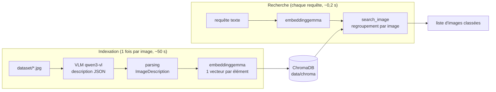
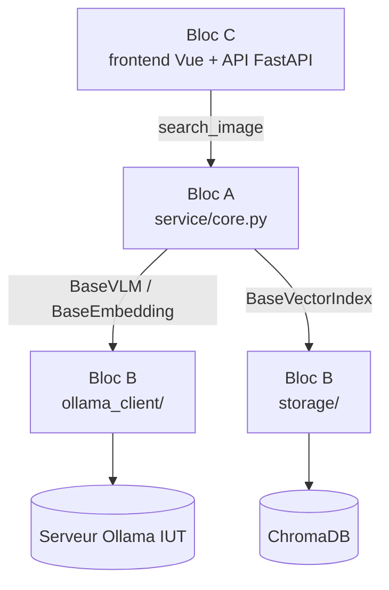

# Architecture

## Vue d'ensemble

Le projet fonctionne en deux temps :

- **l'indexation**, lente, une fois par image : le VLM décrit la photo, chaque
  élément de la description est transformé en vecteur et rangé dans ChromaDB ;
- **la recherche**, rapide, à chaque requête : le texte de l'utilisateur est
  transformé en vecteur par le même modèle d'embedding et comparé à l'index.
  Le VLM n'intervient pas à ce moment-là.

## Découpage en blocs

Chaque membre possède un périmètre de code. La répartition complète est dans
`docs/COMMON_REPORT.md`.

| Bloc | Responsable | Périmètre |
|---|---|---|
| A - Perception & Retrieval | DHESDIN Valentin | `service/`, schéma, prompt, parsing, indexation, recherche, `dataset/`, CI |
| B - Infra & données | GOBFERT Frédéric | `ollama_client/`, `storage/` |
| C - Interface & livraison | LEVITRE Mathys | `frontend/`, `docker/`, `docker-compose.yml`, API |

La règle entre blocs :

- le **Bloc C** n'appelle que les fonctions de service du Bloc A
  (`search_image` pour la recherche) ;
- le **Bloc A** n'utilise le Bloc B qu'à travers ses interfaces abstraites
  (`BaseVLM`, `BaseEmbedding`, `BaseVectorIndex`), jamais Ollama ou ChromaDB
  en direct.

Grâce à ces interfaces, tous les tests du Bloc A tournent avec de faux
modèles et un faux index, sans réseau.

## Bloc A - Perception & Retrieval

Responsable : DHESDIN Valentin.

Le Bloc A transforme une image en entrées d'index, puis retrouve des images à
partir d'un texte.

| Composant | Fichier | État sur main |
|---|---|---|
| Schéma d'extraction (`ImageDescription`, `DetectedObject`, `BoundingBox`) | `service/schemas.py` | Fait, testé |
| Prompt d'extraction VLM | `service/prompts.py` | Fait, cohérence avec le schéma vérifiée par un test |
| Parsing défensif de la réponse VLM | `service/parsing.py` | Fait, 11 tests |
| Listing du dataset | `service/dataset_loader.py` | Fait, testé |
| Conversion en texte et métadonnées (`object_to_text`, `bbox_to_metadata`, `image_to_metadata`) | `service/utils.py` | Fait, testé |
| Indexation d'une image (`index_image`) | `service/core.py` | Fait, 12 tests, essai réel le 10/11 |
| Indexation d'un dossier (`index_dataset`) | `service/core.py` | Fait, 3 tests, 30 images indexées sur le serveur IUT |
| Recherche (`search_image`) | `service/core.py` | Fait, 9 tests, évaluée sur 10 requêtes |
| Reprise d'une indexation interrompue | - | Pas fait |

Les trois fonctions de `core.py` sont asynchrones, comme les adaptateurs du
Bloc B, mais les appels sont faits l'un après l'autre (pas de parallélisme).

Les choix de conception sont expliqués dans
[Choix techniques](choix-techniques.md), les mesures dans
[Essais et mesures](essais.md).

## Bloc B - Infra & données

Responsable : GOBFERT Frédéric.

Le Bloc B fournit l'accès aux modèles et au stockage, derrière des
interfaces que le Bloc A consomme.

**Accès aux modèles** (`src/v_crop_rag/ollama_client/`) :

- `base.py` : interfaces `BaseVLM.generate(prompt, image) -> str` et
  `BaseEmbedding.embed(text) -> list[float]`, toutes deux asynchrones ;
- `vlm.py`, `embedding.py` : adaptateurs `OllamaVLM` et `OllamaEmbedding`,
  qui valident leurs entrées puis délèguent au wrapper ;
- `ollama_wrapper_iut.py` : client HTTP asynchrone (httpx) fourni par l'IUT,
  qui parle à l'API d'Ollama (`/api/generate`, embeddings, liste des
  modèles). Timeout par défaut : 60 s.

**Stockage** (`src/v_crop_rag/storage/`) :

- `base.py` : interface `BaseVectorIndex` avec `add(id, vector, metadata)`
  et `query(vector, k) -> list[VectoreSearchResult]` ;
- `chroma.py` : `ChromaVectorIndex`, implémentation persistante sur disque
  avec ChromaDB.

Le passage en asynchrone des adaptateurs et du wrapper a été fusionné sur
main le 11/10/2026 (PR #16). Le détail du stockage est sur la page
[Stockage vectoriel](stockage.md).

<!-- TODO (Frédéric) : compléter si besoin (choix de conception des
     adaptateurs, évolutions prévues : exists, upsert, métrique cosinus). -->

## Bloc C - Interface & livraison

Responsable : LEVITRE Mathys.

Le Bloc C porte l'interface web, l'API qui la relie au moteur, et la
conteneurisation. Ce travail est **sur des branches**, pas encore sur main :

| Élément | Où | Contenu constaté |
|---|---|---|
| Interface web | branche `dev` (PR #15 du 08/10/2026) | Vue 3 + Vite + Pinia : page d'accueil, zone de saisie, fil de conversation avec bulles de messages, alertes, centre d'aide |
| Docker | branche `dev` (PR #14) | `docker/Dockerfile` qui construit le frontend et le sert sur le port 8080, `docker-compose.yml` avec le frontend et un service ChromaDB |
| API | branches `feat/MainRouter`, `feat/ResponsesRouter`, `backend` | FastAPI : routes `/`, `/health` et `/responses`, qui renvoient pour l'instant des réponses fixes |

Sur main, `docker/Dockerfile` et `docker-compose.yml` existent mais sont
vides. L'API n'appelle pas encore `search_image` : c'est la prochaine étape
d'intégration, une fois le format de réponse validé ensemble (voir
[Comprendre un résultat](../utilisateur/resultats.md#resultat-dune-recherche)).

<!-- TODO (Mathys) : compléter avec l'architecture de l'interface et de
     l'API une fois fusionnées sur main. -->
